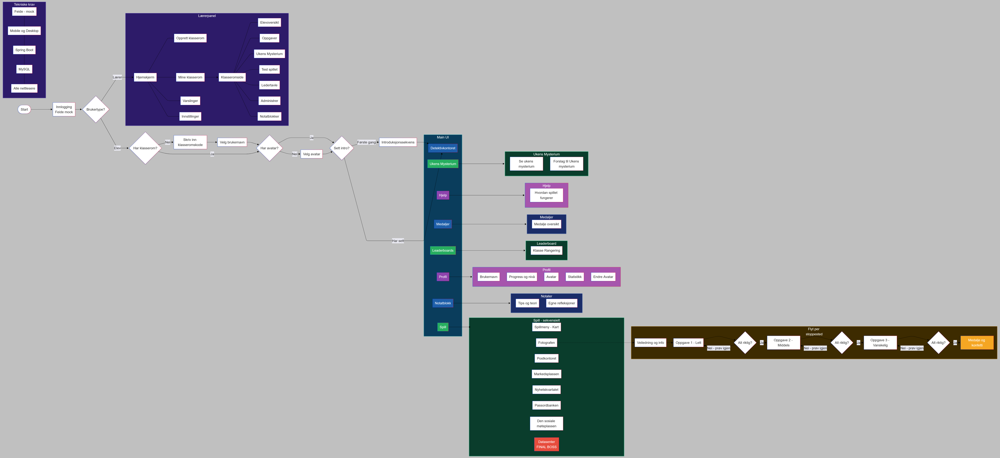
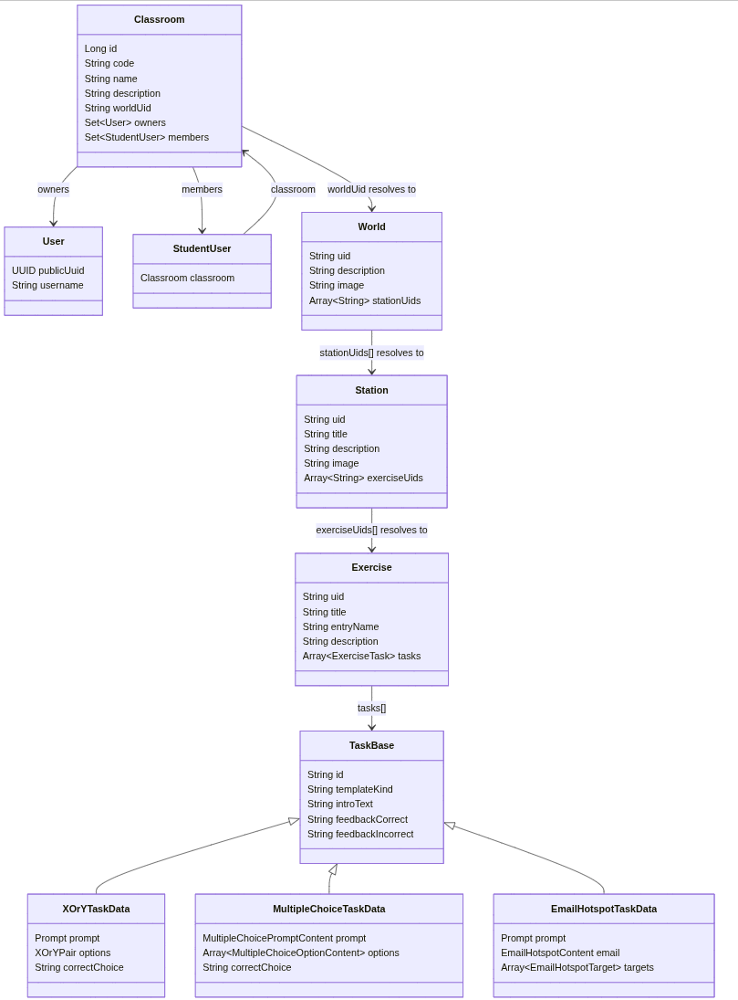

# idatt2106_2026_02

```` møteplass
Oppmøterom: B22 (Berg-bygget)
Oppmøtetid: 09:00 - 15:00
````

### Medlemmer
- **Ole-Kristian Wigum**
- **Casper Kolsrud**
- **William Holtsdalen**
- **Hector Mendana Morales**
- **Alexander Tawan Atjanthuek Johnsen**
- **Amadeus Syvertsen Berg**
- **Wayan Satria Krabseth**
- **Sasha Unruh**

## Developer Setup

### Requirements

- Docker Desktop if you want to run the full stack with Docker
- Node.js or Bun if you want to run the frontend locally
- Java 21 if you want to run the backend locally

### Create `.env`

Create a `.env` file in the project root based on `.env.example`.

Example:

```env
DB_USERNAME=your_db_username
DB_PASSWORD=your_db_password
JWT_SECRET_KEY=your_jwt_secret_key
NUXT_SESSION_PASSWORD=your_nuxt_session_password
```

### Run Everything With Docker Compose

This starts MySQL, backend, and frontend together.

```bash
docker compose up --build
```

Services:

- Frontend: `http://localhost:3000`
- Backend: `http://localhost:8080`
- MySQL: `localhost:3306`

Stop containers:

```bash
docker compose down
```

If the database volume needs to be removed as well, run:

```bash
docker compose down -v
```

If `down` is not enough, use `down` first and then `down -v` to fully remove the database volume.

After code changes, rebuild with:

```bash
docker compose up --build
```

### Run Frontend Locally

You can run the frontend without Docker using either `npm` or `bun`.

With `npm`:

```bash
cd frontend
npm install
npm run dev
```

With `bun`:

```bash
cd frontend
bun install
bun run dev
```

Frontend local URL:

- `http://localhost:3000`

### Run Backend Locally

```bash
cd backend
./mvnw spring-boot:run
```

The backend expects the database and other values from the root `.env`.

## Test Data

Backend seeds demo users and classrooms for local testing.

### Login

Shared password for all demo accounts: `test123`

Teacher accounts:
- `lisa.laerer@test.com` (`Lisa Lærer`)
- `per.laerer@test.com` (`Per Lærer`)

Student accounts:
- `ada.elev@test.com` (`Ada Elev`)
- `elias.elev@test.com` (`Elias Elev`)
- `sara.elev@test.com` (`Sara Elev`)
- `noah.elev@test.com` (`Noah Elev`)
- `ingrid.elev@test.com` (`Ingrid Elev`)
- `emil.elev@test.com` (`Emil Elev`)
- `mia.elev@test.com` (`Mia Elev`)
- `lukas.elev@test.com` (`Lukas Elev`)

### Classrooms

- `Klasse 5B` with code `SUPER-SKOG-KOPP`
- `Klasse 6A` with code `MODIG-TAVLE-BRUS`
- `Nettdetektivene` with code `KONGE-LAVA-TRE`

### Current memberships

- `Ada Elev`, `Elias Elev` and `Sara Elev` belong to `Klasse 5B`
- `Noah Elev` and `Ingrid Elev` belong to `Klasse 6A`
- `Emil Elev` belongs to `Nettdetektivene`
- `Mia Elev` and `Lukas Elev` are not in a classroom yet

Teachers can log in directly to test teacher views. Students already assigned to a classroom can log in and test student flows without joining first. Use `Mia Elev` or `Lukas Elev` together with the join codes above to test classroom join flows.

### Aktivitetsdiagram


### Spill modell code

