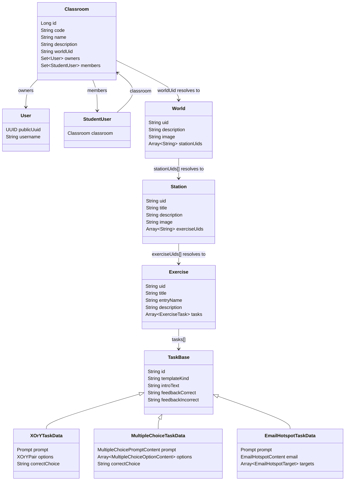

# Domain Model

This diagram reflects the current code as implemented.

- `Classroom` is a backend entity.
- `World`, `Station`, `Exercise`, and `Task` are currently frontend content models.
- A classroom points to one world through `worldUid`.
- The content chain uses UID references, not nested persistence relations:
  - `World.stationUids: string[]`
  - `Station.exerciseUids: string[]`

## Notes

- `Classroom` stores one `worldUid`, which links a classroom to a single world.
- `World` does not currently have a `title`; it uses `uid`, `description`, `image`, and `stationUids`.
- `World -> Station` and `Station -> Exercise` are resolved through UID arrays in the frontend models.
